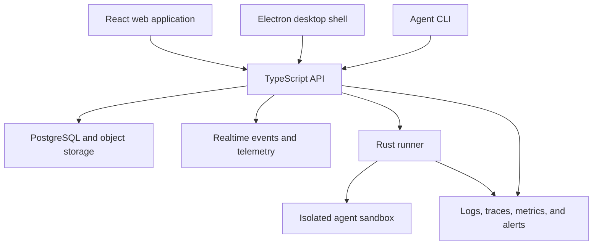

# AgentMonitor

AgentMonitor is a full-stack platform for executing, observing, and operating AI agents in isolated runtimes. The repository combines a React control plane, a TypeScript API and CLI, an Electron desktop shell, a Rust sandbox runner, infrastructure automation, and end-to-end validation.

## Core capabilities

- Submit, resume, cancel, and inspect long-running agent workflows.
- Stream run events, logs, checkpoints, artifacts, and usage telemetry.
- Execute agents in isolated sandboxes with explicit process-control and filesystem boundaries.
- Manage model providers, secrets, connectors, schedules, workflows, and hosted artifacts.
- Operate through a web application, CLI, desktop shell, and API.
- Collect application traces and host metrics through OpenTelemetry-compatible services and Grafana Alloy provisioning.
- Validate runtime behavior with TypeScript, Rust, Playwright, and Bats test suites.

## System design



## Repository layout

```text
AgentMonitor/
├── turbo/
│   ├── apps/api/            Hono-based API and background services
│   ├── apps/cli/            Agent and platform command-line interfaces
│   ├── apps/desktop/        Electron desktop and computer-use shell
│   ├── apps/host-worker/    Hosted-site worker
│   ├── apps/platform/       React and Vite control plane
│   └── packages/            Shared contracts, connectors, database, core, and UI
├── crates/                  Rust runner, sandbox, guest, IPC, and vsock crates
├── ansible/                 Runner deployment and monitoring automation
├── e2e/                     Bats and Playwright end-to-end tests
├── docker/                  Development and CI toolchain images
└── scripts/                 Local development and infrastructure utilities
```

## Prerequisites

The web and API workspace requires:

- Node.js `>=22.19`
- pnpm `10.33.4` through Corepack
- PostgreSQL and any external services enabled in the selected configuration

The runner workspace additionally requires:

- Rust with Edition 2024 support
- Linux for Firecracker-based sandbox execution
- Docker for image and integration workflows

Windows can run repository inspection and much of the TypeScript toolchain, but the low-level runner and several Bash workflows require Linux or WSL 2.

## TypeScript workspace

Install the locked dependency graph:

```powershell
cd turbo
corepack enable
corepack pnpm install --frozen-lockfile
```

Environment configuration is app-specific:

- `turbo/apps/platform/.env.example` documents the browser-facing variables.
- `turbo/apps/platform/.env.local.tpl` and `turbo/apps/api/.env.local.tpl` use secret-manager references for local injection.
- Local resolved values belong in `.env.local`, which is ignored by Git.

Start components independently when working on a focused area:

```powershell
# Web application: http://localhost:3002
corepack pnpm --filter @vm0/app dev

# API: http://localhost:3001
corepack pnpm --filter api start
```

The aggregate `pnpm dev` workflow also starts development tunnel and integration helpers. It requires the corresponding external credentials and command-line tools.

## Rust runner workspace

```bash
cd crates
cargo check --workspace
cargo test --workspace
```

The runner is split into reusable crates for sandbox lifecycle, guest initialization, artifact transfer, process-control IPC, copy-on-write storage, and host/guest vsock transport.

## Observability

AgentMonitor records operational signals across the control plane and runtime:

- API tracing through OpenTelemetry instrumentation.
- Error reporting integrations for API and desktop processes.
- Searchable run logs and lifecycle telemetry.
- Host-level collection through `ansible/playbooks/provision-monitoring.yml`.
- Grafana Alloy configuration for system metrics and textfile collector output.
- Watchdog and health-check coverage in runtime and end-to-end tests.

## Validation

### TypeScript

```powershell
cd turbo
corepack pnpm lint
corepack pnpm check-types
corepack pnpm test
```

Targeted validation is available through workspace filters:

```powershell
corepack pnpm --filter @vm0/app test
corepack pnpm --filter api test
corepack pnpm --filter @vm0/cli test
```

### Rust

```bash
cd crates
cargo fmt --all -- --check
cargo clippy --workspace --all-targets
cargo test --workspace
```

### End to end

The `e2e/` directory contains Bats suites for runner and platform behavior plus Playwright browser tests. These suites require a configured development stack and should be run from Linux or the project dev container.

## Security and deployment notes

- Never commit resolved `.env.local` files, private keys, or generated connector credentials.
- Secret template files contain secret-manager references, not resolved credentials.
- Sandbox and runner changes should be validated on Linux because process isolation, namespaces, vsock, and Firecracker behavior cannot be verified from Windows alone.
- Deployment, release, cleanup, and image workflows require repository-specific GitHub secrets and infrastructure. Review their inputs before enabling them in a new GitHub environment.

