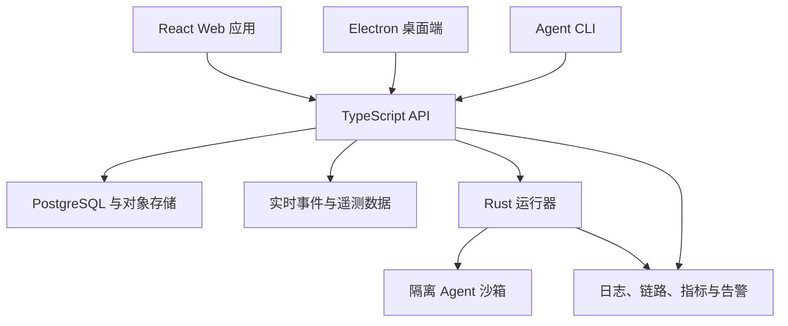

# AgentMonitor

AgentMonitor 是一个用于在隔离运行时中执行、观测和运维 AI Agent 的全栈平台。仓库包含 React 控制平面、TypeScript API 与 CLI、Electron 桌面端、Rust 沙箱运行器、基础设施自动化以及端到端验证。

## 核心能力

- 提交、恢复、取消和检查长时间运行的 Agent 工作流。
- 实时传输运行事件、日志、检查点、产物和用量遥测数据。
- 在隔离沙箱中执行 Agent，并明确限制进程控制和文件系统访问边界。
- 管理模型提供方、密钥、连接器、定时任务、工作流和托管产物。
- 通过 Web 应用、CLI、桌面端和 API 操作平台。
- 通过兼容 OpenTelemetry 的服务和 Grafana Alloy 配置采集应用链路与主机指标。
- 使用 TypeScript、Rust、Playwright 和 Bats 测试套件验证运行时行为。

## 系统设计



## 仓库结构

```text
AgentMonitor/
├── turbo/
│   ├── apps/api/            基于 Hono 的 API 与后台服务
│   ├── apps/cli/            Agent 与平台命令行界面
│   ├── apps/desktop/        Electron 桌面端与 computer-use shell
│   ├── apps/host-worker/    托管站点 Worker
│   ├── apps/platform/       React 与 Vite 控制平面
│   └── packages/            共享协议、连接器、数据库、核心逻辑与 UI
├── crates/                  Rust 运行器、沙箱、guest、IPC 与 vsock crate
├── ansible/                 运行器部署与监控自动化
├── e2e/                     Bats 与 Playwright 端到端测试
├── docker/                  开发与 CI 工具链镜像
└── scripts/                 本地开发与基础设施工具
```

## 运行条件

Web 与 API 工作区需要：

- Node.js `>=22.19`
- 通过 Corepack 使用 pnpm `10.33.4`
- PostgreSQL，以及所选配置中启用的外部服务

运行器工作区还需要：

- 支持 Edition 2024 的 Rust
- 使用 Linux 运行基于 Firecracker 的沙箱
- 使用 Docker 完成镜像和集成工作流

Windows 可用于查看仓库和运行大部分 TypeScript 工具链，但底层运行器和部分 Bash 工作流需要 Linux 或 WSL 2。

## TypeScript 工作区

按照锁定的依赖版本安装：

```powershell
cd turbo
corepack enable
corepack pnpm install --frozen-lockfile
```

环境配置按应用分别管理：

- `turbo/apps/platform/.env.example` 记录浏览器端所需的环境变量。
- `turbo/apps/platform/.env.local.tpl` 和 `turbo/apps/api/.env.local.tpl` 使用密钥管理器引用，在本地注入配置。
- 解析后的本地配置应写入 `.env.local`；该文件已被 Git 忽略。

开发单个模块时，可以分别启动对应组件：

```powershell
# Web 应用：http://localhost:3002
corepack pnpm --filter @vm0/app dev

# API：http://localhost:3001
corepack pnpm --filter api start
```

统一的 `pnpm dev` 工作流还会启动开发隧道和集成辅助工具，因此需要相应的外部凭据和命令行工具。

## Rust 运行器工作区

```bash
cd crates
cargo check --workspace
cargo test --workspace
```

运行器由多个可复用 crate 组成，分别处理沙箱生命周期、guest 初始化、产物传输、进程控制 IPC、写时复制存储以及 host/guest vsock 通信。

## 可观测性

AgentMonitor 在控制平面和运行时两侧记录运维信号：

- 通过 OpenTelemetry 插桩采集 API 链路。
- 为 API 和桌面端进程接入错误上报。
- 提供可检索的运行日志和生命周期遥测数据。
- 通过 `ansible/playbooks/provision-monitoring.yml` 采集主机级数据。
- 使用 Grafana Alloy 配置采集系统指标和 textfile collector 输出。
- 通过运行时测试和端到端测试覆盖 watchdog 与健康检查。

## 验证

### TypeScript

```powershell
cd turbo
corepack pnpm lint
corepack pnpm check-types
corepack pnpm test
```

可通过工作区过滤器进行定向验证：

```powershell
corepack pnpm --filter @vm0/app test
corepack pnpm --filter api test
corepack pnpm --filter @vm0/cli test
```

### Rust

```bash
cd crates
cargo fmt --all -- --check
cargo clippy --workspace --all-targets
cargo test --workspace
```

### 端到端测试

`e2e/` 目录包含验证运行器和平台行为的 Bats 测试套件，以及 Playwright 浏览器测试。运行这些测试需要配置好开发环境，并应在 Linux 或项目开发容器中执行。

## 安全与部署说明

- 不要提交已解析的 `.env.local` 文件、私钥或生成的连接器凭据。
- 密钥模板文件中保存的是密钥管理器引用，而不是解析后的凭据。
- 沙箱和运行器的改动应在 Linux 上验证，因为 Windows 无法验证进程隔离、namespace、vsock 和 Firecracker 的行为。
- 部署、发布、清理和镜像工作流依赖仓库专用的 GitHub secrets 和基础设施。在新的 GitHub 环境中启用这些工作流前，应先检查其输入参数。
